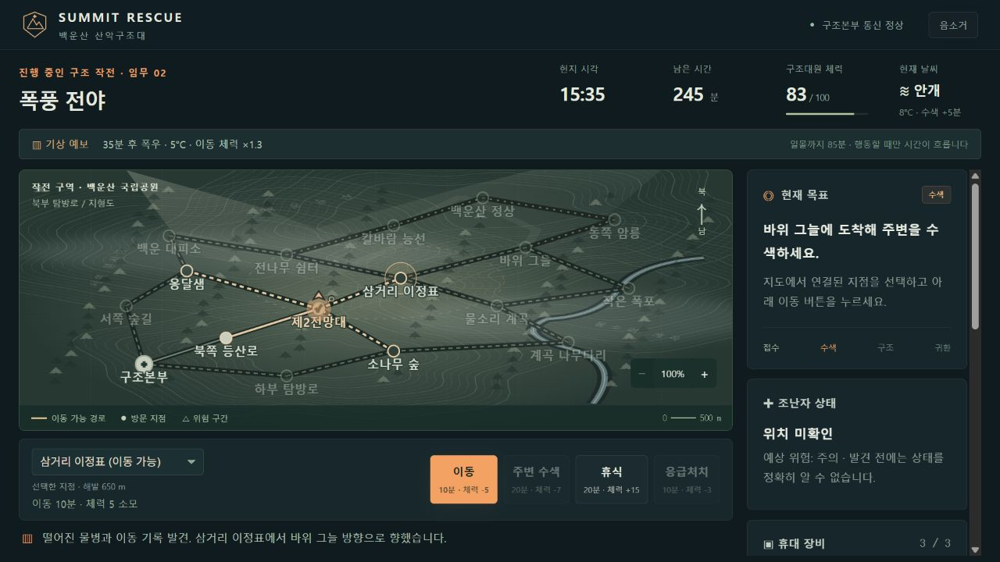

# SUMMIT RESCUE · 서밋 레스큐

> 정상에 오르는 것이 목표가 아니다. 모두 살아 돌아오는 것이 목표다.

한국어로 플레이하는 턴 기반 산악 구조 전략 게임입니다. React + TypeScript + Vite와 직접 제작한 SVG 지형도를 사용합니다. 게임 서버, 계정, 외부 API, 유료 서비스, 원격 폰트·이미지 없이 실행됩니다.



## 실행

Node.js 22.12 이상 또는 24 LTS를 권장합니다.

```sh
npm ci
npm run dev
```

터미널에 표시되는 로컬 주소를 브라우저에서 여세요. 기본 주소는 `http://127.0.0.1:5173`이며, 포트 사용 중에는 Vite가 다음 포트를 사용합니다.

```sh
npm test          # 게임 규칙·밸런스·저장 데이터 테스트
npm run build    # TypeScript 검사 및 dist/ 정적 빌드
npm run preview  # 빌드한 게임 미리 보기
npm run format   # 코드 서식 정리
```

`dist/`를 정적 웹 호스팅에 올릴 수 있습니다. 현재 앱은 상대 경로를 사용하고 도메인이나 비밀 환경변수를 요구하지 않습니다. GitHub 저장소에 코드를 올리는 것만으로 게임 사이트가 자동 배포되지는 않습니다.

## 구현된 게임

- 메인 메뉴 → 임무 선택 → 구조 요청·장비 선택 → 수색 → 조난자 발견 → 응급처치 → 동행 귀환 → 평가.
- 17개 탐색 지점, 22개 경로, 숲·계곡·능선·전망대·대피소·절벽·본부가 있는 지형도.
- 연결된 경로만 이동 가능. 이동 애니메이션, 탐색 완료 표시, 방문 경로, 이동 가능한 길, 확대·축소.
- 조난자는 시드로 결정되는 세 후보 위치 중 한 곳에 있습니다. 제2전망대의 단서와 호루라기·드론 단서는 실제 위치와 연결됩니다.
- 체력·시간·생존 상태, 기본 응급처치, 휴식, 임무 중단, 성공·실패, 별 1~3개 평가.
- 발견 전 생존 상태 비공개, 발견 이후 수치 표시. 구조본부로 돌아와야 성공합니다.
- 다섯 가지 임무, 장비 5종과 3슬롯 제한, 예보와 기상 효과, 선택 이벤트 4종.
- 브라우저 기록, 임무별 누적 성공 수·최고 평가·최단 구조 시간·최고 생존 상태. 최근 상세 기록은 100개, 누적 최고 기록은 계속 보존합니다.
- 키보드 지도 선택, 모바일용 이동 지점 선택 목록, 모달 포커스 이동, 동작 감소 설정, 선택형 Web Audio 알림음·음량 조절.

## 임무와 밸런스

| 임무             | 제한  | 작전                                                                            |
| ---------------- | ----- | ------------------------------------------------------------------------------- |
| 01 사라진 등산객 | 180분 | 맑은 날 튜토리얼. 기본 처치와 단서만으로 구조 가능                              |
| 02 폭풍 전야     | 280분 | 흐림 → 안개(+35분) → 폭우(+70분) → 강풍(+130분) → 폭설(+190분), +120분부터 야간 |

모든 시간은 실제 대기 시간이 아닌 행동으로 경과하는 **게임 내 시간**입니다. 기상 타임라인은 전술 선택을 위한 가상 훈련 시나리오입니다. 임무 1~5의 이동·수색 비용은 시작 시점 날씨로 고정되며, 조난자 상태 감소는 행동 도중 넘어가는 기상 경계까지 분 단위로 계산됩니다. 우회는 지도에 존재하는 여러 경로를 따라가며 각 구간 진입 시점 비용을 합산합니다.

기본 이동 10분/체력 5, 가파른 길 20분/12, 수색 15분/7, 휴식 20분/+15, 기본 응급처치 10분/3입니다. 동행 시 이동 시간은 1.2배, 체력은 1.4배로 올림합니다. 폭우는 이동 체력 1.3배, 폭설은 이동 시간 1.3배, 안개는 수색 +5분, 랜턴 없는 야간 수색은 +10분입니다.

기본 응급처치는 임무당 한 번 상태를 최대 22 회복하고 부상에 의한 악화를 완화합니다. 응급키트는 별도로 두 번, 최대 25씩 회복합니다. 방한포는 사용 이후 추위·야간에 의한 추가 악화를 55% 줄입니다. 로프는 가파른 길 체력 소모를 4 줄이고 급류의 빠른 길을 사용할 수 있게 합니다. 드론은 두 구간 이내에서 단서를 탐지하며 강풍에서는 사용할 수 없습니다.

급류의 우회로와 로프 길, 강풍 능선의 대기·우회·강행은 시간·체력·상태 비용이 다릅니다. 선택 전에 비용이 표시되고, 이동 이벤트를 취소한 뒤 휴식하거나 다른 길을 고를 수 있습니다. 장비 없이도 간이 보온과 안전한 우회가 가능합니다. 무작위 즉사 판정은 없습니다.

작전 시드에 `0`, `1`, `2`를 넣으면 각각 전나무 쉼터, 물소리 계곡, 바위 그늘을 재현할 수 있습니다. 시드는 출동마다 기록되며 다시 같은 시드로 플레이해도 별도 출동으로 집계됩니다.

## 코드 구성

| 파일                    | 역할                                                                 |
| ----------------------- | -------------------------------------------------------------------- |
| `src/game.ts`           | 지도 그래프, 순수 상태 전이, 행동 비용, 이벤트, 생존 상태 계산, 승패 |
| `src/conditions.ts`     | 임무 설정, 날씨 타임라인, 예보, 장비 정의                            |
| `src/App.tsx`           | 메뉴·작전 화면·결과·설정, 입력 잠금, 음향                            |
| `src/Map.tsx`           | SVG 지형도, 경로·조난 수색 표시, 날씨·이동 애니메이션                |
| `src/MissionPanels.tsx` | 임무 선택, 장비 선택, 예보, 선택 이벤트 화면                         |
| `src/storage.ts`        | 버전 호환 LocalStorage 기록 및 설정                                  |
| `src/*.test.ts`         | 핵심 규칙, 구조 경로, 장비·날씨·이벤트, 저장 테스트                  |

동일 명령 중복 적용을 막기 위해 UI 입력 잠금과 게임 상태의 revision 검사를 함께 사용합니다. 시간에 따른 생존 상태 변화는 `advance()` 한 곳에서 처리합니다. 1단계의 이동·수색·구조·귀환 구조를 유지한 채 2단계를 확장했습니다.

## 검증

자동 테스트는 두 임무의 모든 조난자 후보 위치, 2단계의 직접 경로·숲길 경로와 네 장비 구성(장비 없음 포함), 기상 경계, 장비 효과·횟수 제한, 이벤트 선택 비용, 잘못된 이동, 중복 명령, 실패·재시작, 기존 저장 형식 마이그레이션·저장 차단을 확인합니다.

브라우저에서는 2번 임무 시드 1을 직접 플레이해 **153분 / 생존 상태 71 / 체력 18 / 별 3개**로 귀환했습니다. 발견·보온·응급처치·급류 선택·날씨 전환·결과·새로고침 후 기록 복원을 확인했습니다. 390px 화면에서 이동 버튼 조작, 연속 클릭 시 1회 처리, 임무 중단과 재시작도 확인했습니다.

## 현재 제한과 다음 단계

- 진행 중인 임무의 중간 저장은 없습니다. 새로고침하면 메뉴로 돌아가며 완료 기록과 설정만 유지됩니다.
- 데이터는 해당 브라우저에 저장되므로 다른 기기와 동기화되지 않습니다. 저장 차단·용량 부족 시 게임은 계속 작동하고 기록 저장 실패를 알립니다.
- 기존 백운산과 신규 세 지역은 각각 독립된 17개 지점 지도입니다. 임무별 조난자 후보는 세 곳입니다. 임무 1~5의 드론은 현재 위치 주변의 단서 탐지 방식이며 임무 6은 지정 구역 비행입니다.
- 작은 화면에서는 지도를 가로로 스크롤할 수 있고 이동 목록으로 지점을 고를 수 있습니다. 확대 지도는 중앙 기준이며 자유 드래그 이동은 없습니다.
- 음향은 간단한 합성 알림음입니다. 환경음·음성 무전·음향의 청각 품질은 별도 제작·검증하지 않았습니다.
- 브라우저 QA는 Chromium 기반 환경에서 수행했습니다. Safari/Firefox 실기기, 장시간 플레이 및 실제 첫 사용자 5~10분 플레이타임은 미검증입니다.
- 다음 개선 대상: 진행 중 임무 저장, 초보자 플레이테스트와 난이도 조정, 지도 자유 이동, 환경음 및 더 다양한 단서 연출.
- 멀티플레이·과금·3D 월드·서버 계정은 범위에서 제외했습니다. 성장과 제한적인 항공 지원은 3·4단계에서 추가했습니다.

## 향후 도메인 연결

현재는 도메인을 사용하지 않습니다. 추후 도메인 기반 링크·콜백·CORS 등을 도입할 때는 `APP_DOMAIN` / `APP_ORIGIN`을 환경별 설정으로 읽고 `.env.example` 및 배포 문서를 갱신해야 합니다. 실 도메인을 소스에 하드코딩하지 않습니다. DNS·인증서·운영 라우팅 변경 전에는 Cloudflare 활성 존의 네임서버와 Gabia의 등록 상태·만료일을 확인해야 합니다.

## 3단계: 산악 구조 작전

- **안개가 삼킨 능선**: 계룡산 모티브의 안개 능선. 무전 강도는 지도 경로 거리로 계산하며 서로 다른 지점의 측정 결과로 후보를 교차 검증합니다. 오래된 발자국은 불확실한 정보로 표시하고 현장에서 순찰 흔적임을 확인할 수 있습니다.
- **위험한 암릉**: 설악산 모티브의 바람의 암릉. 강풍 때 일부 지름길은 로프 없이 통행할 수 없습니다. 안전 우회로는 길지만 체력 부담이 작습니다. 부상자는 기본 처치 후 이동하며 동행 부담이 증가합니다.
- **마지막 불빛**: 지리산 모티브의 밤의 숲길. 30분 뒤 일몰, 15분 간격 구조 불빛, 랜턴 시야·수색 효과와 귀환 중 대피소 보온 정비가 적용됩니다.

지역마다 독립된 노드·경로·팔레트·환경 효과를 사용합니다. 실제 산의 지형을 재구성한 가상 구조 구역으로 실제 등산로나 구조 지침이 아닙니다.

임무는 이전 임무 성공으로 해금되고 완료한 임무는 재도전할 수 있습니다. 임무 선택 화면의 **훈련 모드**로 모든 임무를 체험할 수 있지만 기록과 경험치는 저장되지 않습니다. 기본 처치·장비·시간·수색·승패 구조는 1·2단계 엔진을 확장했습니다.

성공 시 100 + 별당 25 경험치를 받습니다. 탐색·산악 이동·구조 대응은 각각 최대 3단계, 훈련 비용은 100/175/250입니다. 효과는 출동 시 고정됩니다. 저장 형식 v3는 v1 배열과 v2 누적 기록을 보존하며, 이전 성공 1회당 100 경험치를 소급합니다. 새로고침 후에도 보유 경험치·능력·해금·평가가 유지됩니다.

신규 임무의 무작위 범위는 후보 3곳 × 기상 타이밍 3종입니다. 시드 0~8이 모든 조합을 대표하고 9를 더하면 같은 후보와 예보를 재현합니다. 새 지역을 추가하려면 `regions.ts`의 지도와 `conditions.ts`의 임무 데이터를 확장합니다. 성장 규칙은 `progression.ts`에 분리했습니다.

3단계 검증: 자동 테스트 **104개** 통과. 신규 27개 조합과 암릉 빠른 경로 9개 모두 성장 없이 성공, 기존 56개 회귀 통과. 브라우저에서 안개 임무 시드 2를 신호 분석부터 귀환까지 144분·상태 81·3별로 완료했으며 암릉·야간 지도도 시각 확인했습니다. 첫 사용자 7~15분 플레이 시간, 실제 환경음 품질, Safari/Firefox는 아직 검증하지 않았습니다. 음향은 기존 합성 무전 알림음을 유지합니다.

## 4단계: 구조대 지휘 작전

실행: `npm ci` → `npm run dev`. 임무 5 성공 후 **임무 06: 두 개의 구조 신호**가 열립니다. 바로 체험하려면 임무 선택에서 **훈련 모드**를 켜세요. 시드 0은 북쪽 전나무 쉼터·계곡 물소리 계곡을 재현합니다.

1. 출동 편성에서 대원마다 장비를 최대 3개 배정합니다. 재고는 키트·방한포·로프·랜턴 각 2개, 드론 1대입니다. 모두 본부에서 출발합니다.
2. 대원 카드의 체크박스로 단독 또는 같은 위치의 팀을 선택합니다. 지도 또는 구역 목록과 명령을 지정해 예약합니다. 각 대원은 하나의 명령만 수행합니다.
3. **작전 진행**은 하나의 공통 시계로 가장 먼저 완료되는 명령까지 진행합니다. 다른 명령의 잔여 시간은 유지합니다. 날씨 변화·생존 소진 시 정지하며 재개 버튼이 필요합니다. 실시간 자동 진행은 없습니다.
4. 북쪽은 제2전망대, 계곡은 나무다리를 수색하거나 항공 정찰로 단서를 확보합니다. 대상 구역에서 지상 수색해야 발견됩니다.
5. 현장 대원으로 처치한 뒤 **동행 편성**을 지시합니다. **본부 복귀**는 연결 경로를 한 구간씩 이동하며, 다음 구간 체력이 부족하면 정지하고 휴식을 요청합니다. 동행 담당 전원이 함께 이동해야 합니다.
6. 두 대상의 인계와 대원 전원 귀환을 달성하면 자동 종료됩니다. 일부만 구했다면 전원 본부 귀환 후 작전 종료 또는 철수 결정을 합니다. 360분은 수색 마감이며 이후에도 안전 귀환·처치·휴식은 가능합니다. 고립된 대원을 순간이동시키거나 종료 처리하지 않습니다.

| 대원   | 현장 능력                                                                | 전문 성장 (200 XP마다, 최대 3단계) |
| ------ | ------------------------------------------------------------------------ | ---------------------------------- |
| 김도현 | 수색 8분, 인접 1구간 추가 흔적 분석                                      | 수색 단계당 −1분, 최소 5분         |
| 이서진 | 처치 8분, 회복 +12, 동행 이동 부담 감소, 함께 이동 중 상태 악화 25% 감소 | 처치 회복 단계당 +2                |
| 박민호 | 가파른 길 체력 −4, 위험 경로 비용 감소                                   | 위험 경로 체력 단계당 추가 −1      |

성장과 장비는 출동 시 고정됩니다. 원격 대원의 능력은 적용되지 않습니다. 팀 이동 시간은 가장 느린 구성원 기준이고 체력 비용은 개별 적용합니다. 이동 중 폭우의 체력 배율과 조난자별 상태 악화는 매분 반영합니다. 수색 시간은 예약 당시 시야·야간 장비에 따라 결정됩니다. 기존 임무 1~5 엔진과 SVG 지도를 유지하고, 공통 조난자 형식·상태 악화 계산을 공유합니다.

**드론:** 배터리 100, 반경 4구간. 왕복·비상 귀환 예비분을 포함한 비용은 20 + 거리×12 + 험지 10입니다. 왕복 소요 시간은 10 + 거리×4분. 소지자 한 명이 현장에 대기하며, 정찰 구역 주변 1구간의 미발견 대상 흔적과 위험 경로 정보를 전달합니다. 강풍·폭우·폭설은 출동 불가, 비행 도중 악화되면 8분 이내 자동 귀환하며 정찰 보고는 얻지 못합니다. 본부·대피소에서 20분에 50 충전합니다. 항공 정보만으로 발견·구조를 완료하지 않습니다.

**헬기:** 임무당 2회, 한 번에 한 대, 요청·도착까지 30분. 맑음·흐림에서만 운용하고 도착 시 기상을 다시 검사합니다. 정찰은 지정 구역 주변 2구간 단서, 환자 이송은 발견한 생존 대상·현장 대원·H 지점·부상자 처치가 필요합니다. 선택한 대원도 공식 이송됩니다. 좁은 계곡·절벽에서는 이송할 수 없습니다. 출발 이후 취소·실패해도 지원 횟수는 소모됩니다. 항공기는 지도상의 구역·경로·맥동 표식으로 표현하며 물리 비행은 구현하지 않습니다.

평가는 `commandData.ts`의 기준으로 계산합니다. S는 2명 구조·전원 귀환·230분 이내·두 대상 생존 50 이상, A는 2명 구조·전원 귀환, B는 1명 구조·전원 귀환, C는 미달성입니다. 별과는 S=3/A=2/B·C=1로 호환됩니다. 정규 출동의 공용 경험치는 S/A/B에 200/150/75, 실제 활동한 각 대원은 그 절반의 전문 경험치를 얻습니다. 훈련은 저장·보상이 없습니다.

저장 v4는 v1 배열/v2/v3 완료 기록·누적 통계·기존 성장·해금을 유지하며 대원 경험치, 최고 등급, 누적 구조 인원, 드론·헬기 사용을 보관합니다. 결과 저장은 출동 ID로 중복 방지합니다. 진행 중 작전 저장·기기 간 동기화는 제공하지 않습니다.

추가 파일: `command.ts` (예약·공통 시계·항공·평가), `commandData.ts` (대원·장비·등급 데이터), `casualties.ts` (공통 조난자 형식·악화 계산), `CommandScreen.tsx` (편성·지휘·결과), `command.test.ts` (56개 지휘·저장 테스트). `App.tsx`, `Map.tsx`, `MissionPanels.tsx`, `conditions.ts`, `game.ts`, `storage.ts`, `styles.css`를 확장했습니다.

검증: **160개 자동 테스트 통과**, TypeScript 및 프로덕션 빌드 통과. 임무 6의 후보 3×3와 기상 타이밍 3종을 조합한 시드 0~26 모두 성장 없이 분산 지상 구조 성공. 공통 시계·중복 예약·정지·현장 처치·왕복 배터리·기상 제한·헬기 도착 재검사·부분 성공·실패·등급 경계·저장 이전 및 기존 104개 테스트를 확인했습니다. 브라우저에서 시드 0을 단서 확인부터 **157분 / 생존 85·89 / 전원 귀환 / S등급**까지 완료했습니다. 드론 보고, 폭우에서 헬기 회항, 지상 귀환 전환, 재도전, 390px 모바일 조작과 데스크톱 레이아웃을 확인했고 콘솔 경고·오류는 없었습니다.

검증 화면: [지휘 화면](screenshots/rescue-command.jpg), [완료 결과](screenshots/rescue-command-result.jpg).

제한: 지휘는 임무 6 전용이며 이전 임무는 단독 구조 방식을 유지합니다. 본부 복귀는 최단 구간 수 경로를 선택하므로 안전 우회로를 직접 지시할 수 있습니다. 대원의 부상·사망이나 구조 요청 경제 시스템은 없으며 체력 부족 시 휴식합니다. 음향은 기존 합성 알림음이고 음성 무전·환경음·항공 물리·온라인 기능은 없습니다. 실제 초보자 플레이 시간과 Safari/Firefox는 미검증입니다. 다음 개선 권장사항은 초보자 테스트에 따른 비용 조정, 저장 상태 검증을 포함한 중간 저장, 이동 경로 사전 비교, 접근성·브라우저 교차 검사입니다.
